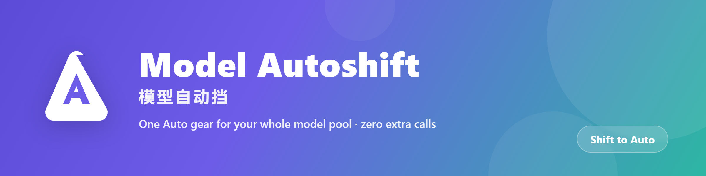

[](LICENSE)
[](https://github.com/Ylsssq926/dsh-autoshift/actions/workflows/ci.yml)
[](package.json)
[](https://github.com/Ylsssq926/dsh-autoshift)
[](README.md)
[](CONTRIBUTING.md)

# Model Autoshift (模型自动挡)

> Encore à choisir vos modèles en manuelle ? Passez en automatique.

Vous avez accumulé des tas de modèles via des relais, et vous en choisissez encore un à la main pour chaque tâche ? Model Autoshift ajoute un cran **Auto** au sélecteur de modèles de DSH : déposez une tâche et il choisit le meilleur modèle parmi ceux que vous avez déjà configurés — les modèles économiques pour les corvées, les flagships pour les os durs. Une route épinglée pour toute la session, aucune dérive après un redémarrage, zéro appel de modèle supplémentaire.

Vous apportez la tâche. Auto choisit le modèle.

[中文](README.md) · [English](README.en.md) · [日本語](README.ja.md) · [한국어](README.ko.md) · **Français** · [Español](README.es.md) · [Deutsch](README.de.md) · [Русский](README.ru.md)


## Pourquoi Auto

- **Zéro config** : installez, choisissez Auto, c'est parti. Pas de pool à remplir, pas de YAML. Chaque modèle configuré dans DSH — officiel ou relais — est reconnu, y compris les ID inconnus.
- **Change de vitesse selon la tâche** : ingénierie, créatif, rédaction, recherche, architecture et conversation quotidienne — six types de tâches appariés automatiquement, les modèles économiques pour les corvées, les flagships pour le difficile.
- **Une session, une route** : le premier modèle choisi reste épinglé pour toute la session. La compaction du contexte et les redémarrages du bureau récupèrent la route au lieu de la recalculer, gardant le contexte et le cache fournisseur stables.
- **Zéro appel supplémentaire** : chaque requête est transmise à un seul modèle — pas de « modèle routeur » qui brûle un second appel, pas de vote, pas de préchauffe, pas de nouvelle tentative par défaut. L'usage passe tel quel ; la facture reste la même.
- **Chaque tour en un coup d'œil** : une ligne de reçu à la fin de chaque réponse — `Auto · model · tier · role` — montre qui a tourné, quel niveau, et si un secours a été utilisé.

## Pour qui

- **Utilisateurs intensifs de relais** : des dizaines ou centaines de modèles, plus de changement manuel par tâche ;
- **Utilisateurs multi-fournisseurs** : DeepSeek, OpenAI, Gemini, Claude mélangés, dispatchés par tâche ;
- **Débutants** : évitez la recherche sur les modèles, choisissez Auto, commencez.

## Installation

```bash
dsh plugin --profile web add -w link:/path/to/model-aware-auto-plugin
```

Redémarrez DSH et activez le plugin. Les nouvelles sessions affichent **Model Autoshift → Auto** dans le sélecteur de modèles. Utilisez `--profile desktop` pour l'application de bureau.

## Démarrage rapide

1. Configurez au moins un modèle texte dans les réglages DSH (officiel ou relais) ;
2. Nouvelle session, choisissez **Auto** ;
3. Assignez la tâche.

C'est tout.


## Trois modes

| Mode | Comportement |
|---|---|
| `economy` | Les corvées vont aux modèles économiques ; le coût pèse le plus |
| `balanced` (défaut) | Adéquation à la tâche d'abord, coût considéré |
| `quality` | Adéquation à la tâche uniquement, coût ignoré |

```yaml
mode: economy
```

## Exemples de tâches

| Rôle | Ce que vous déposez |
|---|---|
| Ingénierie | Corriger une trace d'erreur, refactorer une fonction, écrire un script, déployer une API, lancer des tests |
| Créatif | Écrire un poème, inventer une histoire, jeu de rôle, rédiger une accroche |
| Rédaction | Peaufiner un e-mail, résumer un article, traduire, rédiger un rapport hebdo |
| Recherche | Explorer la littérature, comparer des options, lancer un benchmark |
| Architecture | Conception système, choix techno, découpage en microservices |
| Quotidien | Discussion, Q&R, corvées diverses |

Quel que soit le rôle lu dans la tâche, Auto choisit un modèle pour ce rôle dans votre pool — corvées en economy, os durs en flagship.

## Modèles relais reconnus sans config

Les pools relais sont pleins d'ID inconnus. Auto les classe par nom et dispatche :

- **Economy** : `mini / flash / lite / haiku / free / turbo`, plus les petits modèles open-weight comme `7b / 8b` ;
- **Flagship** : `pro / opus / ultra / max`, plus les modèles de raisonnement comme `r1 / o3 / reasoner / thinking` ;
- **Penchant ingénierie** : `coder / code / dev`, famille deepseek / claude ; **penchant créatif** : famille gemini.

Une variante économique d'une famille flagship (`pro-flash`) compte toujours comme economy. La transmission utilise toujours l'ID exact du catalogue. Pour affiner le coût ou les rôles, surchargez avec `economics` dans `preferences` / `routes`.

## Épinglé pour la session, aucune dérive au redémarrage

La première route réussie lie toute la session. Après une compaction du contexte ou un redémarrage du bureau, la liaison est récupérée depuis les événements de session, jamais recalculée ; le contexte n'est jamais mélangé entre modèles, et le préfixe stable est ami du cache fournisseur. Si le modèle épinglé est démonté, Auto vous indique la prochaine étape au lieu de changer silencieusement de modèle en pleine conversation.

## Reçu de route

Une petite ligne à la fin de chaque tour : `Auto · model · tier · role`, plus `fallback×N` quand un secours a été utilisé. Elle lit les métadonnées de route déjà dans la session — zéro requête supplémentaire ; les tours non-Auto n'affichent rien.

## Répartition des sous-agents (optionnel)

Quand l'outil subagent natif de DSH active la sélection de modèle et que la session a une politique enfant, Auto fait un appariement de rôle local plus un court passage de relais pour les sous-tâches **sans modèle explicite**. Les modèles subagent choisis explicitement gagnent toujours ; le démarrage, l'annulation, les permissions et le recyclage restent natifs à DSH.

## Permissions et données

Auto lit uniquement vos catalogues de modèles montés et les événements de la session courante, et ne transmet qu'aux fournisseurs que vous avez configurés. Il ne touche jamais aux fichiers de l'espace de travail et n'envoie aucune télémétrie ; toute la config reste locale.

## Configuration (tout est optionnel)

### Préférences légères

```yaml
preferences:
  - provider: your-provider-id
    model: exact-model-id
    roles: [engineering]
```

Les préférences n'ajustent que l'ordre ; les autres modèles montés participent toujours.

### Contrôle de portée

```yaml
scope:
  providers: [provider-a, provider-b]   # liste d'autorisation, vide = tout
  excludeProviders: [provider-c]
  excludeModels: [some-model]
```

### Profils avancés

Une liste `routes` complète remplace la découverte automatique pour des flux d'équipe fixes ou un réglage long terme : `roles`, `tools`, `behavior`, `dimensions`, `economics`, `contextWindow`, `maxOutputTokens`, `routeRevision`. Utilisez les vrais ID provider/model de DSH ; pas de clé API dans la config.

## Bon à savoir

- Tâches texte uniquement ; les modalités image sont hors du catalogue d'Auto ;
- Les anciennes sessions démarrées avec un autre modèle ne peuvent pas passer à Auto en cours de route — démarrez une nouvelle session ;
- Les requêtes auxiliaires (titres, résumés) suivent la route épinglée de la session.

## Compatibilité

DSH `0.2.2-rc.1` · Node.js 22+.

## Architecture


## Développement

```bash
node --test
```

## Licence

Apache-2.0 © 2026 掠蓝 (Ylsssq926). Toute réutilisation ou œuvre dérivée doit conserver l'attribution [LICENSE](LICENSE) et [NOTICE](NOTICE) et indiquer les modifications importantes.