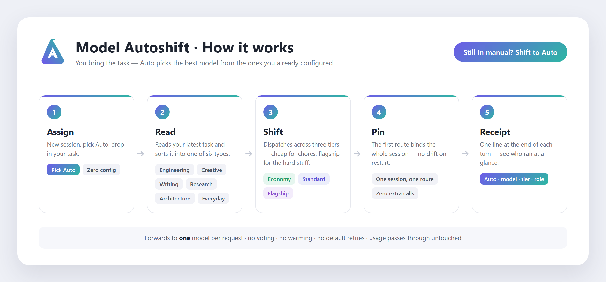
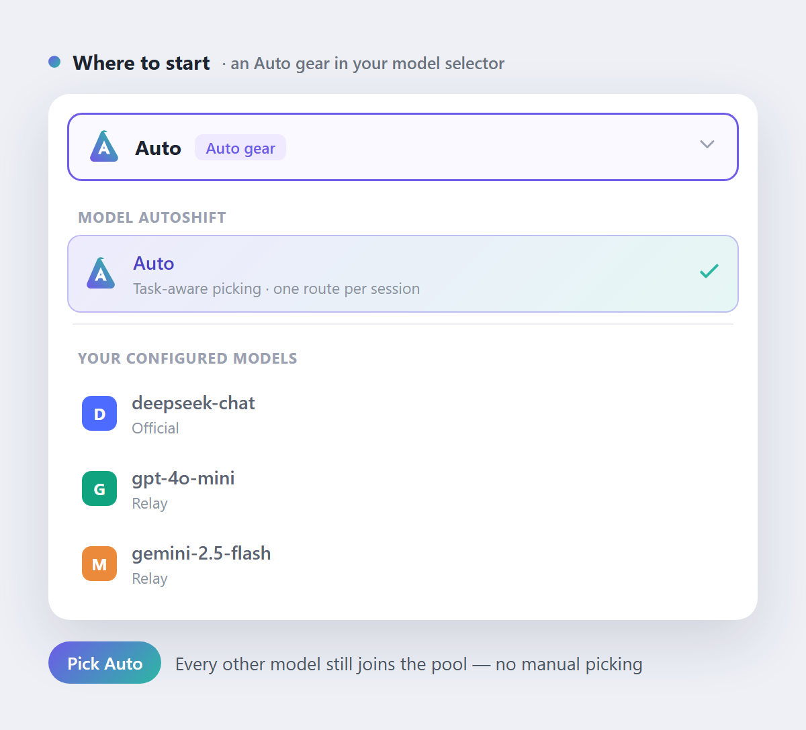

[](LICENSE)
[](https://github.com/Ylsssq926/dsh-autoshift/actions/workflows/ci.yml)
[](package.json)
[](https://github.com/Ylsssq926/dsh-autoshift)
[](README.md)
[](CONTRIBUTING.md)

# Model Autoshift（模型自动挡）

> まだ手動でモデルを選んでる？ Auto に切り替えよう。

中継サービスでモデルを山ほど集めたのに、タスクごとにまだ手動で一つ選んでる？ Model Autoshift は DSH のモデルセレクターに **Auto** ギアを追加します。タスクを投げれば、設定済みのモデルから最適なものを自動で選びます。雑用は安いモデルに、難題はフラッグシップに。1セッション1ルートで固定、再起動してもずれず、追加のモデル呼び出しはゼロ。

あなたはタスクを出すだけ。モデル選びは Auto に任せよう。

[中文](README.md) · [English](README.en.md) · **日本語** · [한국어](README.ko.md) · [Français](README.fr.md) · [Español](README.es.md) · [Deutsch](README.de.md) · [Русский](README.ru.md)



## Auto を使う理由

- **設定ゼロで開始**：インストールして Auto を選べばすぐ使える。モデルプールも YAML も不要。DSH に設定したモデル——公式でも中継でも——は見知らぬ ID も含めてすべて認識。
- **タスクで変速**：エンジニアリング・クリエイティブ・ライティング・リサーチ・アーキテクチャ・日常の6種類を自動マッチ。雑用は安く、難題はフラッグシップ。
- **1セッション1ルート**：最初に選んだモデルがセッション全体に固定。コンテキスト圧縮やデスクトップ再起動でもルートを復元し、再選択しない。コンテキストとプロバイダーキャッシュが安定。
- **追加呼び出しゼロ**：各リクエストは1モデルにのみ転送。「ルーターモデル」で二度課金せず、投票もウォームアップもデフォルト再試行もなし。usage はそのまま透過、請求は普段どおり。
- **毎ターン一目で把握**：返信末尾に1行のレシート `Auto · model · tier · role`。誰が・どのティアで・バックアップを使ったかが一目瞭然。

## こんな人に

- **中継ヘビーユーザー**：数十〜数百のモデル、タスクごとの手動切り替えから解放；
- **マルチプロバイダーユーザー**：DeepSeek・OpenAI・Gemini・Claude を混在、タスクで自動 dispatch；
- **初心者**：モデルの違いを調べたくない、Auto を選んで開始。

## インストール

```bash
dsh plugin --profile web add -w link:/path/to/model-aware-auto-plugin
```

DSH を再起動してプラグインを有効化。新規セッションのモデルセレクターに **Model Autoshift → Auto** が現れます。デスクトップ版は `--profile web` を `--profile desktop` に。

## クイックスタート

1. DSH 設定でテキストモデルを1つ以上設定（公式・中継どちらでも）；
2. 新規セッションでモデルに **Auto** を選択；
3. タスクを投げる。

これだけ。



## 3つのモード

| モード | 動作 |
|---|---|
| `economy` | 雑用は安いモデル優先、コストの重みが最大 |
| `balanced`（デフォルト） | タスク適合優先、コストも考慮 |
| `quality` | タスク適合のみ、コスト無視 |

```yaml
mode: economy
```

## タスク例

| ロール | 投げるタスク |
|---|---|
| エンジニアリング | エラー修正、関数リファクタ、スクリプト作成、API デプロイ、テスト実行 |
| クリエイティブ | 詩を書く、物語を作る、ロールプレイ、コピー作成 |
| ライティング | メール推敲、記事要約、翻訳、週報作成 |
| リサーチ | 文献調査、選択肢比較、ベンチマーク |
| アーキテクチャ | システム設計、技術選定、マイクロサービス分割 |
| 日常 | 雑談、Q&A、さまざまな雑用 |

読み取ったロールに合わせてプールからモデルを選択。雑用は economy、難題はフラッグシップ。

## 設定ゼロで中継モデルを認識

中継プールは見知らぬ ID だらけ。Auto は名前でティア分けして dispatch：

- **economy**：`mini / flash / lite / haiku / free / turbo`、 plus `7b / 8b` などの小型オープンウェイトモデル；
- **flagship**：`pro / opus / ultra / max`、 plus `r1 / o3 / reasoner / thinking` などの推論モデル；
- **エンジニアリング寄り**：`coder / code / dev`、deepseek / claude ファミリー；**クリエイティブ寄り**：gemini ファミリー。

フラッグシップ家の安いバリアント（`pro-flash`）も economy 扱い。転送は常にカタログの正確な ID。コストやロールを微調整するには `preferences` / `routes` の `economics` で上書き。

## セッションに固定、再起動でずれない

最初の成功ルートがセッション全体にバインド。コンテキスト圧縮やデスクトップ再起動後はセッションイベントからバインドを復元し、再選択しない。モデル間でコンテキストを混在させず、安定プレフィックスはプロバイダーキャッシュに優しい。固定モデルがアンマウントされたら、Auto は黙ってモデルを切り替えず次のステップを案内。

## ルートレシート

各ターン末尾に小さな1行：`Auto · model · tier · role`、バックアップ使用時は `fallback×N`。セッション内の既存ルートメタデータを読むだけで追加リクエストゼロ。Auto 以外のターンには表示しない。

## サブエージェント分担（オプション）

DSH ネイティブの subagent がモデル選択を有効化し、セッションに子ポリシーがある場合、Auto は**モデル未指定**のサブタスクにローカルなロールマッチと短い引き継ぎを1回実行。明示指定した subagent モデルが常に優先。起動・キャンセル・権限・回収は DSH ネイティブのまま。

## 権限とデータ

Auto はマウント済みのモデルカタログと現在のセッションイベントのみを読み、設定済みプロバイダーにのみ転送。ワークスペースファイルの読み書きやテレメトリ送信はせず、設定はすべてローカルに保持。

## 設定（すべてオプション）

### 軽量 preference

```yaml
preferences:
  - provider: your-provider-id
    model: exact-model-id
    roles: [engineering]
```

preference は順序を調整するだけ。他のマウント済みモデルも通常どおり参加。

### スコープ制御

```yaml
scope:
  providers: [provider-a, provider-b]   # 許可リスト、空 = すべて
  excludeProviders: [provider-c]
  excludeModels: [some-model]
```

### 高度なプロファイル

完全な `routes` リストは自動発見を上書き。チーム固定フローや長期チューニング向け：`roles`、`tools`、`behavior`、`dimensions`、`economics`、`contextWindow`、`maxOutputTokens`、`routeRevision`。実際の DSH provider/model ID を使用。設定に API キーは書かない。

## 注意事項

- テキストタスクのみ。画像モダリティは Auto のカタログ外；
- 他モデルで始めた旧セッションは途中で Auto に切り替え不可。新規セッションを作成；
- タイトル・要約などの補助リクエストはセッションの固定ルートに従う。

## 互換性

DSH `0.2.2-rc.1` · Node.js 22+。

## アーキテクチャ


## 開発

```bash
node --test
```