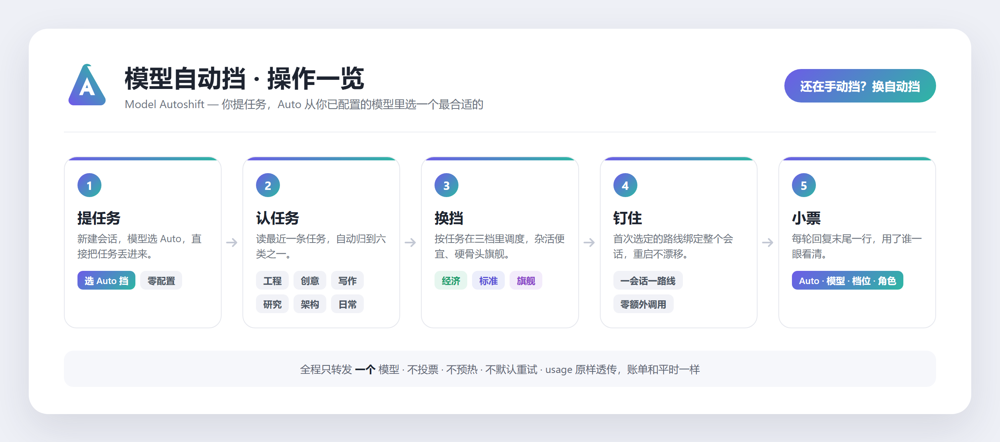
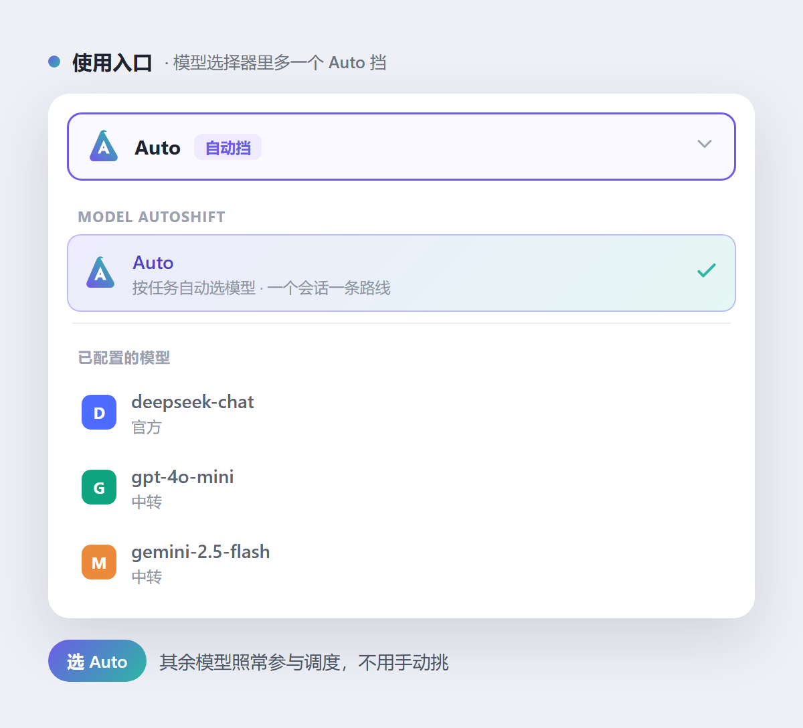
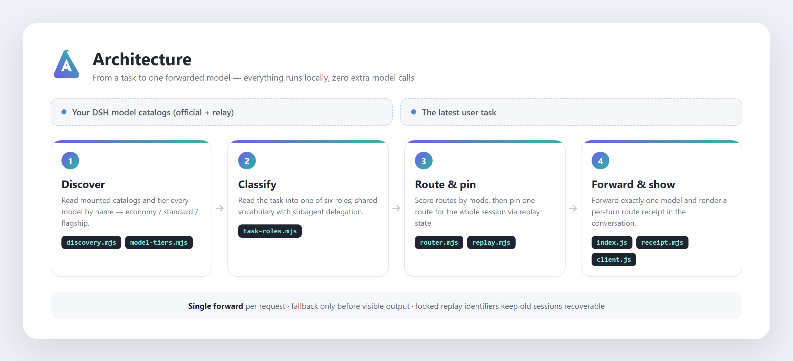

[](LICENSE)
[](https://github.com/Ylsssq926/dsh-autoshift/actions/workflows/ci.yml)
[](package.json)
[](https://github.com/Ylsssq926/dsh-autoshift)
[](README.md)
[](CONTRIBUTING.md)

# 模型自动挡（Model Autoshift）

> 还在手动挡选模型？换自动挡。

中转站攒了一堆模型，每次任务还要手动挑一个？模型自动挡在 DSH 的模型选择器里加一个 **Auto** 挡：任务丢进来，它从你已配置的模型里自动挑一个最合适的——杂活交给便宜模型，硬骨头交给旗舰。一个会话认死一条路线，重启也不漂移，全程不多花一次模型调用。

你只管提任务，选模型的事交给 Auto。

**中文** · [English](README.en.md) · [日本語](README.ja.md) · [한국어](README.ko.md) · [Français](README.fr.md) · [Español](README.es.md) · [Deutsch](README.de.md) · [Русский](README.ru.md)



## 为什么用 Auto

- **零配置上手**：装好选 Auto 就能用，不填模型池、不写 YAML。你在 DSH 配好的模型——官方或中转——它都认得，没见过的 ID 也照常参与。
- **按任务换挡**：工程、创意、写作、研究、架构、日常对话六类任务自动匹配，便宜的干杂活、旗舰啃硬骨头。
- **一个会话一条路线**：首次选定的模型钉住整个会话，上下文压缩、桌面重启都不重新选路，上下文和供应商缓存稳稳的。
- **零额外调用**：每次只转发一个模型，没有"路由模型"再烧一次钱，不投票、不预热、不默认重试。usage 原样透传，账单和平时一样。
- **每轮一眼看清**：回复末尾一行小票 `Auto · 模型 · 档位 · 角色`，用了谁、什么档、有没有切备选，一目了然。

## 适合谁

- **中转站重度用户**：池子里几十上百个模型，不想每次手动切；
- **多供应商用户**：DeepSeek、OpenAI、Gemini、Claude 混配，按任务自动调度；
- **新手**：不想研究模型差异，选 Auto 直接开始。

## 安装

```bash
dsh plugin --profile web add -w link:/path/to/model-aware-auto-plugin
```

重启 DSH 并启用插件。新建会话，模型选择器里出现 **Model Autoshift → Auto**。桌面端把 `--profile web` 换成 `--profile desktop`。

## 快速开始

1. DSH 设置里配好至少一个文本模型（官方或中转均可）；
2. 新建会话，模型选 **Auto**；
3. 直接提任务。

就这样。



## 三档模式

| 模式 | 行为 |
|---|---|
| `economy` | 杂活优先便宜模型，成本权重最高 |
| `balanced`（默认） | 任务适配优先，兼顾成本 |
| `quality` | 只看任务适配，不计成本 |

```yaml
mode: economy
```

## 场景示例

| 角色 | 你丢进来的任务 |
|---|---|
| 工程 | 修报错、重构函数、写脚本、部署接口、跑测试 |
| 创意 | 写诗、编故事、角色扮演、想文案 |
| 写作 | 润色邮件、总结文章、翻译、写周报 |
| 研究 | 调研文献、对比方案、做评测 |
| 架构 | 系统设计、技术选型、微服务拆分 |
| 日常 | 闲聊、问答、各种杂活 |

认成什么角色，就按什么角色去池子里挑模型；杂活走经济档，硬骨头上旗舰。

## 零配置认得中转模型

中转池里大多是没见过的模型 ID，Auto 看名字就能分档调度：

- **经济档**：`mini / flash / lite / haiku / free / turbo`，以及 `7b / 8b` 这类小参数开源模型；
- **旗舰档**：`pro / opus / ultra / max`，以及 `r1 / o3 / reasoner / thinking` 这类推理模型；
- **工程偏好**：`coder / code / dev`，deepseek / claude 家族；**创意偏好**：gemini 家族。

`pro-flash` 这种旗舰家的便宜变体仍按经济档算。转发永远用目录里的原始 ID。想精调成本或角色，`preferences` / `routes` 里写 `economics` 覆盖即可。

## 会话钉住，重启不漂移

首次成功的路线绑定整个会话。上下文压缩、桌面重启后从会话记录恢复绑定，不重新选路；不同模型的上下文绝不混传，稳定前缀对供应商缓存友好。绑定的模型被卸载时，Auto 明确告诉你下一步，不偷偷换模型续写。

## 路由小票

每轮回复末尾一行小字：`Auto · 模型 · 档位 · 角色`，切过备选会标 `备选×N`。用的是会话里已有的路线记录，不加任何请求；非 Auto 回合不显示。

## 子代分工（可选）

DSH 原生 subagent 启用模型选择且会话已写入子代策略时，Auto 为**未指定模型**的子任务做一次本地角色匹配和短交接。你显式指定的子代模型永远优先；子代的启动、取消、权限、回收仍由 DSH 原生负责。

## 权限与数据

Auto 只读你已挂载的模型目录和当前会话事件，只向你已配置的 provider 转发请求;不读写工作区文件、不上传遥测，配置全部留在本地。

## 配置参考（全部可选）

### 轻量偏好

```yaml
preferences:
  - provider: your-provider-id
    model: exact-model-id
    roles: [engineering]
```

偏好只调排序，其他已挂载模型照常参与。

### 范围控制

```yaml
scope:
  providers: [provider-a, provider-b]   # 白名单，空 = 全部
  excludeProviders: [provider-c]
  excludeModels: [some-model]
```

### 高级画像

完整 `routes` 覆盖自动发现，适合团队固定流程或个人长期调校：`roles`、`tools`、`behavior`、`dimensions`、`economics`、`contextWindow`、`maxOutputTokens`、`routeRevision`。用 DSH 实际的 provider/model ID，配置不写 API key。

## 使用须知

- 仅文本任务，图片模态不在 Auto 目录内；
- 用其他模型开始的旧会话不能中途切 Auto，新建会话即可；
- 标题、摘要等辅助请求沿用会话已绑定的路线。

## 兼容性

DSH `0.2.2-rc.1` · Node.js 22+。

## 架构



## 开发

```bash
node --test
```